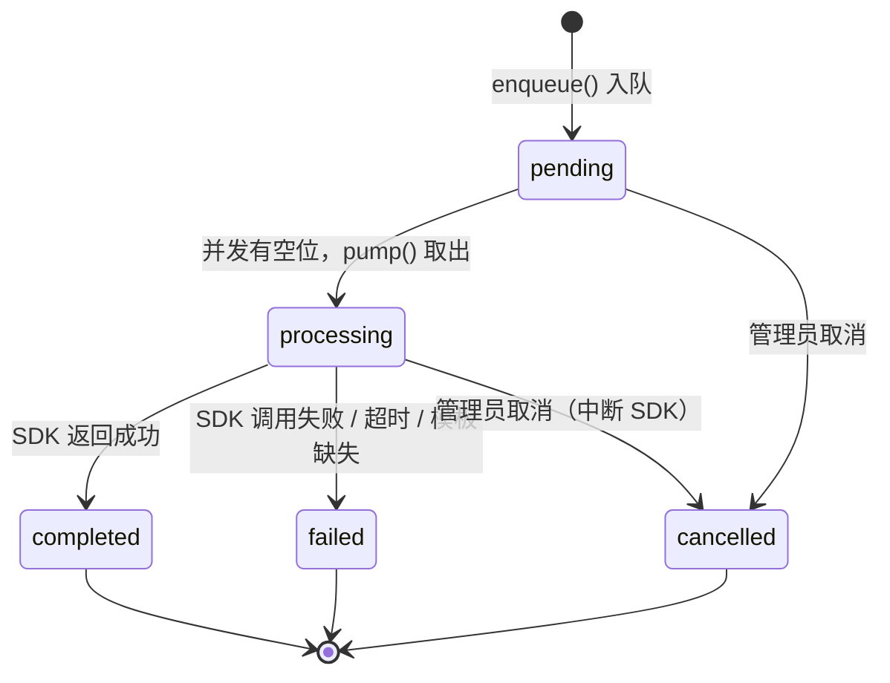

# AI 数字员工 — 自主任务执行平台

接收 JSON → 按 path 查找提示词模板 → 渲染提示词 → 异步调用 Claude Code Agent SDK → 回调结果。

系统本身不做任何业务逻辑（不下载文件、不解析文档、不提取文本），所有"智能"行为由 Claude 通过 Agent SDK 的 tool use 自行完成。

## 快速开始

```bash
# 1. 准备配置
cp data/cfg.yml.template data/cfg.yml
# 编辑 cfg.yml，至少填写 llm.base_url（Anthropic 协议兼容网关地址）

# 2. 安装依赖并编译
npm install
npm run build

# 3. 生成 HTTPS 证书并启动服务（始终 HTTPS）
# 证书由 build/build.sh 构建时自动生成到 deploy/certs/；本地开发可手动生成：
openssl req -x509 -newkey rsa:2048 -sha256 -days 3650 -nodes \
  -keyout deploy/certs/key.pem -out deploy/certs/cert.pem \
  -subj "/C=CN/O=AI数字员工/CN=localhost" \
  -addext "subjectAltName=DNS:localhost,IP:127.0.0.1"
npm start          # HTTPS 模式（读取 deploy/certs/cert.pem、key.pem）
```

本地开发 runner（集群联调用，无需证书/数据库）：

```bash
npm run dev:runner   # 热更启动 runner，监听 RUNNER_PORT（默认 20002）
```

构建产物（同镜像双入口）：

| 产物 | 命令 | 入口 |
|------|------|------|
| 控制面 | `npm run build` | `dist/index.js` → `npm start` |
| Runner | `npm run build:runner` | `dist/runner.js` → `npm start:runner` |
| 全部 | `npm run build:all` | 两者一起产出 |

集群设计文档：`doc/cluster-runner-design.md`。

### Docker 部署（单实例）

```bash
./build/build.sh            # 构建镜像
./build/deploy.sh start     # 启动单实例容器
```

### Docker 集群部署（横向扩展）

单实例之外，可用 docker-compose 起「1 个控制面 + N 个 runner」：

```bash
export RUNNER_TOKEN=你的内网认证token
docker compose -f build/compose.yml up -d                        # 控制面 + runner1
docker compose -f build/compose.yml --profile scale up -d runner2  # 按需追加 runner2
```

- **控制面**：对外 API + 管理后台 + 队列调度 + 唯一 SQLite 写者（挂载 `data/`）
- **runner**：无状态执行节点，只跑 Claude Agent SDK，不挂 `data/`、不读 SQLite、不读 `prompts/`

控制面通过 `cfg.yml` 的 `runner.addresses` 静态列表认识 runner：

```yaml
runner:
  addresses:
    - name: runner-1
      addr: http://runner1:20002   # 内网 http；https 需自签/内网 CA 证书
      capacity: 5
    - name: runner-2
      addr: http://runner2:20002
      capacity: 5
```

- `runner.addresses` 为空 → 退化为单实例本机执行（行为不变，可平滑回滚）
- 修改 runner 列表需**重启控制面**生效（`runners` 表在启动时同步）
- 详细设计见 `doc/cluster-runner-design.md`

**控制面 runner 配置**（`cfg.yml`，均可被环境变量覆盖）：

| 配置 | 环境变量 | 默认 | 说明 |
|------|---------|------|------|
| `runner.token` | `RUNNER_TOKEN` | 空 | 控制面↔runner 认证，只从环境变量读，不写死 |
| `runner.port` | `RUNNER_PORT` | 20002 | runner 监听端口 |
| `runner.heartbeat_ms` | `RUNNER_HEARTBEAT_MS` | 5000 | 心跳间隔 |
| `runner.connect_timeout_ms` | `RUNNER_CONNECT_TIMEOUT_MS` | 5000 | 连接超时 |
| `runner.request_timeout_ms` | `RUNNER_REQUEST_TIMEOUT_MS` | 15000 | 短请求超时 |

**runner 侧环境变量**（不读 `cfg.yml`/SQLite）：

| 变量 | 默认 | 说明 |
|------|------|------|
| `RUNTIME_DIR` | ./runtime | runner 本地工作目录（不挂载，重启丢弃） |
| `RUNNER_PORT` | 20002 | 监听端口 |
| `RUNNER_MAX_CONCURRENT` | 5 | 单 runner 最大并发 SDK 数 |
| `RUNNER_TIMEOUT_MS` | 600000 | 看门狗滑动超时 |
| `RUNNER_GRACE_MS` | 60000 | 看门狗宽限 |
| `RUNNER_USE_HTTPS` | 1 | `0` 退化为 HTTP（内网 compose 用） |
| `RUNNER_TOKEN` | 空 | 与控制面一致 |

## 工作原理

```
外部系统                             AI 数字员工
   |                                     |
   |  POST /api/v1/document/classify     |
   |  {"linkid":"...","callback_url":"...","files":[...], ...}
   | ───────────────────────────────────►|
   |                                     | 1. 按 path 查找提示词模板
   |  {"code":0, "task_id":"uuid"}       | 2. 入队，立即返回
   | ◄───────────────────────────────────|
   |                                     | === 异步 ===
   |                                     | 3. 渲染提示词（{{placeholder}}）
   |                                     | 4. 创建 workdir，调用 Claude Agent SDK
   |                                     |    → Claude 自行 curl 下载文件
   |                                     |    → Claude 自行 Read 文件
   |                                     |    → Claude 分析并输出结构化 JSON
   |  POST {callback_url}                | 5. 回调结果（失败自动重试，指数退避）
   | ◄───────────────────────────────────|
```

## 核心设计

- **Path 即接口**：管理员在 Web 后台为每个 path 配置一段提示词模板，调用方感知为"不同接口"，无需改代码、无需重启
- **占位符渲染**：提示词中用 `{{request.field}}` 引用请求 JSON 中的任意字段
- **无业务逻辑**：系统只是 Claude Agent SDK 的网关壳，所有文档分析判断全交给 LLM
## 任务状态机

任务状态机定义在 `src/types.ts`（状态类型）与 `src/services/task-queue.ts`（转移逻辑）中。



| 状态 | 含义 |
|------|------|
| `pending` | 已入队，等待并发空位 |
| `processing` | 正在调用 Claude Agent SDK |
| `completed` | SDK 处理成功 |
| `failed` | SDK 调用失败、超时、提示词模板缺失，或服务重启时被中断 |
| `cancelled` | 被管理员手动取消 |

**服务重启时的恢复**（`recoverOrphanedTasks()`）：

- DB 中 `pending` 且关联接口模板已被删除 → `failed`
- DB 中 `processing` → `failed`（原进程已退出，任务被中断）
- 其余 `pending` 任务重新入队，继续等待处理

> 说明：系统本身**不投递回调**。回调是 Agent 按提示词指令自行通过 `curl` 调用对方的 `callback_url`，因此回调结果不进入任务状态机。

## 项目结构

```
AI 数字员工/
├── src/
│   ├── index.ts              # 服务入口
│   ├── config.ts             # 配置加载
│   ├── routes/
│   │   ├── process.ts        # POST /api/v1/:path（通配路由）
│   │   ├── tasks.ts          # 任务查询/取消
│   │   ├── admin.ts          # 管理后台 API（接口/模板 CRUD）
│   │   └── auth.ts           # 登录鉴权
│   ├── runner/
│   │   └── index.ts          # runner 入口（无状态 SDK 执行节点）
│   └── services/
│       ├── sdk-core.ts       # SDK 纯执行核心（控制面/runner 共用，无 store 依赖）
│       ├── sdk-runner.ts     # SDK 封装（控制面侧：buildEnv/buildClaudeMd/本地回退）
│       ├── prompt-engine.ts  # 模板查找 + 占位符渲染
│       ├── task-queue.ts     # 异步任务队列（状态机核心）
│       ├── dispatcher.ts     # runner 选路 + 心跳（集群）
│       ├── runner-client.ts  # 控制面→runner HTTP 客户端
│       ├── runner-executor.ts# runner 本地执行器 + 看门狗
│       ├── runner-protocol.ts# 派发协议帧定义
│       └── process-tree.ts   # SDK 子进程树定位/强杀（共用）
├── web/                      # 管理后台前端（内嵌 SPA）
├── prompts/                  # 提示词文件（无需重编译，热更新）
│   ├── doc/                   # 业务提示词（目录结构即访问路径）
│   │   ├── classify.md         → path = doc/classify
│   │   ├── route.md            → path = doc/route
│   │   └── review.md           → path = doc/review
│   ├── claude-md.md            # CLAUDE.md 主模板（Agent 工作区行为规范）
│   └── sections/               # 可插拔的"外部服务调用说明"片段
│       ├── wps.md              # WPS 文件下载回退
│       └── audit.md            # rdCLI 审稿服务
├── data/                     # 运行时数据（SQLite + 日志 + 密钥）
└── build/                    # Dockerfile + 部署脚本
```

### 数据目录与挂载（重要）

数据按「是否需要在容器外持久化」分为三类，Docker 部署时**只挂载第 1 类目录**。

| 类别 | 目录 | 内容 | 持久化 | 说明 |
|------|------|------|--------|------|
| 第 1 类 | `DATA_DIR`（宿主机挂载到 `/app/data`） | `cfg.yml`、`app.db`、`logs/`、`secrets.key` | ✅ 重启保留 | 配置文件、数据库、日志、加密密钥 |
| 第 2 类 | `/app/assets`（镜像内，不挂载） | `cfg.csv.template`、`mock.json` | ✅ 随镜像 | 静态模板资源，构建时打入镜像 |
| 第 3 类 | `RUNTIME_DIR`（容器内，不挂载） | `tasks/`、`claude-config/` | ❌ 重启丢弃 | SDK 工作目录与会话历史，ephemeral |

**环境变量**：

- `DATA_DIR` — 第 1 类持久化数据根目录（默认 `./data`，Docker 中为 `/app/data`）
- `RUNTIME_DIR` — 第 3 类运行时工作目录（默认 `./runtime`，Docker 中为 `/app/runtime`）
- `RUNNER_TOKEN` — 控制面 ↔ runner 认证（集群模式必填，单实例无需）
- `RUNNER_PORT` — runner 监听端口（默认 20002）
- 其余集群配置见上方「Docker 集群部署」节

**关键点**：

- SDK 会话历史写入 `RUNTIME_DIR/claude-config`（通过 `CLAUDE_CONFIG_DIR` 环境变量指定），**不再使用 `~/.claude`**。这避免了宿主机 UID 与容器 UID 不一致时，bind mount 的 `~/.claude` 目录无法写入导致历史消息丢失的问题。
- `tasks/`（每个任务的 SDK 工作目录，含下载的文件、上下文快照）同样放在 `RUNTIME_DIR`，重启后自动丢弃，不影响持久化数据。
- 因此 Docker 部署**不需要**再挂载 `$DATA_DIR/.claude`，`run.sh` 已移除该挂载项。


### 提示词与配置管理（模板管理页面）

所有提示词和业务配置统一在**模板管理页面**（管理员 → 模板管理）通过三步引导式流程管理。

#### 设计原则

| 数据 | 存放位置 | 流向 | 说明 |
|------|----------|------|------|
| 提示词模板（txt） | `prompts/` 目录 | **双向**：可上传 / 可下载 | 下载 → 离线编辑 → 上传覆盖 |
| 业务配置（key/value/说明） | `prompt_config` 表（加密） | **单向加密**：明文不可下载 | CSV 批量上传 / 页面单条增删，AES-256-GCM 加密入库 |

- **明文不可逆**：接口地址、Token 等敏感信息一旦入库就无法再下载明文（页面可查看公开项、脱敏查看敏感项），防止泄露
- **Tar 双向可迭代**：下载当前版本 → 离线修改 → 上传替换，闭环编辑
- **加密密钥分离**：密钥独立存放在 `data/secrets.key`（首次启动自动生成，权限 600），与 `app.db` 分离，单独偷走任一文件无法解密

#### 全局环境变量（`prompt_config` → Agent 子进程）

`prompt_config` 表中的**所有 key-value** 会在每个任务启动时自动注入到 Agent 子进程的环境变量，命名规则：`DP_` 前缀 + key 中点号转下划线 + 全大写。key 不要手动加 `DP_` 前缀。

| prompt_config key | 注入的环境变量 |
|------------------|--------------|
| `current_organization_name` | `DP_CURRENT_ORGANIZATION_NAME` |
| `doc.file_url_token` | `DP_DOC_FILE_URL_TOKEN` |

同时，每个新任务的 `CLAUDE.md` 末尾会自动追加一张「可用环境变量」清单，列出 `变量名 | key | 说明 | 是否敏感`（**只列名字和说明，不写入明文值**）。Agent 既能通过 key 名、也能通过说明理解变量含义，需要时再在 Bash 里 `echo $DP_xxx` 按需取值。

> 兼容：`doc.file_url_token` → `FILE_URL_TOKEN`、`doc_audit.token` → `DOC_AUDIT_TOKEN`、`callback.token` → `CALLBACK_TOKEN` 三个旧命名仍保留，模板中已使用 `$FILE_URL_TOKEN` 等写法不受影响。

**注意**：环境变量清单与 `CLAUDE.md` 一样，仅在**新任务创建时生成一次**；session 复用的旧任务不会拿到后续新增的变量。

#### 三步引导式流程

```
步骤 1                   步骤 2                   步骤 3
上传配置 CSV  ──────────▶ 上传 Prompt tar 包 ─────▶ 预览 / 下载
  │                          │                        │
  │ ① 下载 CSV 模板         │ ① 下载当前 tar         │ 预览所有文件
  │ ② 填写 key/value/说明    │ ② 解压，编辑 txt       │ 下载当前 tar
  │ ③ 上传（加密入库）       │ ③ 打包，上传（校验）   │
  │                          │                        │
  │ CSV 模板格式：           │ tar 包结构：            │
  │ key,value,说明           │ classify.md           │
  │                          │ route.md              │
  │                          │ review.md             │
  │                          │ claude-md.md          │
  │                          │ sections/*.md         │
```

##### 步骤 1：上传配置 CSV

配置支持两种录入方式：**页面直接添加**（推荐少量配置）和 **CSV 批量上传**（适合批量导入）。

**方式一：页面直接添加**

Tab 顶部提供 inline 表单（key / value / 说明），回车或点击「添加」即加密入库。每行右侧有删除按钮，支持单条删除。

**方式二：CSV 批量上传**

CSV 为三列：`key`, `value`, `说明`。点击「下载 CSV 模板」获取空模板，填写后上传。

- key 以 `_token` / `_secret` / `_password` / `_key` 结尾的自动标记为 🔒 敏感项
- 敏感项的 value 默认脱敏显示（`ab****cd`），点击 👁 图标可临时查看明文
- 已配置的数据**无法明文下载**（下载按钮只返回空模板）
- CSV 上传为**全量替换**模式（先清空再批量导入），页面添加为**增量**模式（单条 upsert）

**key 格式校验**（两种方式统一）：

- 非空，≤ 128 字符
- 只允许字母、数字、下划线 `_`、点号 `.`、连字符 `-`，且必须以字母或数字开头
- 不允许包含 `{{` 或 `}}` 占位符标记
- 不允许以 `DP_` 开头（`DP_` 前缀由系统自动添加，手动加上会导致 `DP_DP_` 重复前缀）

##### 步骤 2：上传 Prompt tar 包

首次使用点击「下载当前 tar」获取内置默认模板。解压后所见结构：

```
prompts/
├── doc/                  # 业务提示词目录（目录结构即访问路径）
│   ├── classify.md        → path = doc/classify（收文分类）
│   ├── route.md           → path = doc/route（流转目标识别）
│   └── review.md          → path = doc/review（发文审核）
├── claude-md.md           # CLAUDE.md 主模板（Agent 工作区行为规范）
└── sections/              # 条件段落（可插拔）
    ├── wps.md             # WPS 文件下载回退
    └── audit.md           # rdCLI 审稿服务
```

**路径映射规则**：`prompts/` 下的相对路径去掉 `.md` 后缀即对外访问路径。例如：

- `prompts/doc/classify.md` → 访问路径 `doc/classify`
- `prompts/hr/recruit.md` → 访问路径 `hr/recruit`
- `prompts/finance/approval.md` → 访问路径 `finance/approval`

想要新增入口，在 tar 包里加对应子目录 + `.md` 文件即可，无需改代码。

**排除规则**：`claude-md.md`、`sections/` 目录、以下划线 `_` 开头的文件/目录，不作为访问路径。

离线编辑后打包为 `.tar.gz`，上传时自动执行占位符校验：

- 扫描所有 `.md` 文件中的 `{{...}}` 占位符
- 对照步骤 1 已配置的 key，**key 不存在则拒绝上传并列出缺失项**
- `{{request.*}}` 和 `{{section:...}}` 开头的占位符无需 CSV 配置

##### 步骤 3：预览 / 下载

上传成功后可在步骤 3 中按文件折叠预览模板内容，也可重新下载当前 tar 进入下一轮编辑迭代。

#### 占位符语法

**① 业务提示词（`classify.md` 等）— `{{request.xxx}}`**

运行时由请求 JSON 替换。例如模板里写 `{{request.body}}`，运行时替换为整个请求体。

**② CLAUDE.md — `{{key}}` （来自配置）**

直接引用已配置的 key，运行时替换为对应的 value。例如模板里写 `{{sys.doc_util_url}}`，运行时从 `prompt_config` 表中取 `sys.doc_util_url` 的值替换。

**③ 条件段落 — `{{section:名称:触发key}}`**

语法：`{{section:片段名:配置中的key}}`

只有当配置中对应的 key **有值**时，才会把 `sections/片段名.md` 的内容插入此处；否则整段静默删除。

示例：
```markdown
{{section:audit:doc_audit.api_url}}
```
- `doc_audit.api_url` 在配置中有值 → 读取 `sections/audit.md` 插入
- 为空或不存在 → 整行移除

#### 新增外部服务接口（无需改代码）

假设要新增"组织机构查询服务"：

**① 在配置中新增一行**
```
sys.org_api_url,https://oa-server:8080/api/org,组织机构查询服务地址
```

**② 新建 `sections/org.md`**
```markdown
## 组织机构查询服务

查询组织架构、部门归属关系。接口令牌通过环境变量 `FILE_URL_TOKEN` 提供。

```bash
curl -s -k --noproxy '*' -w'\n' -X GET '{{sys.org_api_url}}/dept/tree' \
  -H "Authorization: Bearer $FILE_URL_TOKEN" | jq '.'
```
```

**③ 在 `claude-md.md` 中添加引用行**
```markdown
{{section:org:sys.org_api_url}}
```

**④ 重新打包 tar 并上传。下一个新任务自动生效。**

#### 注意事项
- `claude-md.md` 和 `sections/*.md` 是**每个新任务启动时读取**的，上传 tar 后下一个新任务立即生效，无需重启服务
- 通过 session 复用的已有任务不会重新读取 CLAUDE.md（首次快照固化）
- `classify.md` / `route.md` / `review.md` 也是**每个新任务启动时从磁盘实时读取**，上传 tar 后即刻生效
- 代码仓库自带的 `prompts/` 目录作为种子模板，首次部署即可用

## 技术栈

| 层 | 技术 |
|----|------|
| 运行时 | Node.js ≥22, TypeScript |
| HTTP | Express.js |
| AI 引擎 | `@anthropic-ai/claude-agent-sdk` |
| 存储 | SQLite (better-sqlite3) |
| 前端 | Vanilla JS SPA |
| 部署 | Docker, 自签 HTTPS |
| 横向扩展 | 控制面 + 无状态 runner（docker-compose 编排） |