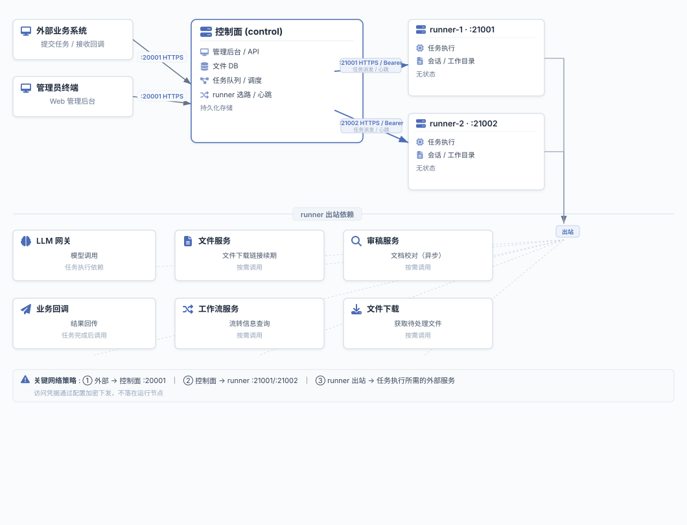

# 部署指南（集群模式 · 微服务）

> 适用分支：cluster。控制面与 runner 分离，**每服务一台服务器**，runner 可水平扩容。

---

## 1. 架构与拓扑

> 端口一览：`20001` = 控制面对外（`HOST_PORT`），`20002` = runner（`RUNNER_PORT`）。
> 外部服务端口由 `cfg.yml` 的 `llm.base_url` 与 `prompt_config` 表（注入为 `DP_*` 环境变量）决定，非固定值。



- **控制面**：唯一 SQLite 写者，挂载 `data/` 持久化目录。轻量，单实例。
- **runner**：无状态执行节点，不读 SQLite / prompts / secrets，本地 `runtime/` 重启即丢。
- **出站依赖**：runner 在执行任务时会以出站方式访问 LLM 网关（`api-gate`）、doc-util（WPS 续期）、rd-cli（审稿，异步+轮询）、业务回调、工作流服务、文件下载白名单。地址/令牌由 `prompt_config` 表加密注入 Agent 子进程环境变量（`DP_*`）。
- 控制面通过 `data/cfg.yml` 的 `runner.addresses` 静态认识各 runner，按容量 + 心跳选路。

---

## 2. 前置要求

| 依赖 | 说明 |
|------|------|
| Docker ≥ 24 | 本脚本用 `docker-compose`（v5 兼容 v2） |
| Node.js ≥ 22 | 仅构建机需要（`build.sh` 读取 `package.json` 版本号） |
| 内网互通 | 控制面能访问各 runner 的 `20002` 端口；runner 能访问 LLM 网关 |
| 镜像分发 | 各服务器需要同一份 `dp-agt` 镜像（推 registry 或 `docker save/load`） |

## 3. 网络策略（内网需申请开通）

> 内网默认端口不通，需向网络管理员申请放行。下表是整套集群**运行时所有**需要的网络策略，缺一条会导致对应功能不可用。

### 3.1 必开策略

| # | 源 | 目的 | 端口 | 协议 | 用途 |
|---|-----|------|------|------|------|
| 1 | 外部业务系统 | 控制面服务器 | `20001` | HTTPS | 提交任务、查询结果 |
| 2 | 管理员终端 | 控制面服务器 | `20001` | HTTPS | 管理后台 |
| 3 | 控制面服务器 | 各 runner 服务器 | `20002` | HTTPS | 任务派发 / 心跳 / 取消 / 会话代理 |
| 4 | 各 runner 服务器 | LLM 网关 | `<网关端口>` | HTTP(S) | 跑 Claude Agent SDK |
| 5 | 控制面服务器 | LLM 网关 | `<网关端口>` | HTTP(S) | 管理后台 chat（不用可不开） |

### 3.2 按需策略（业务相关，runner 出站方向）

| # | 源 | 目的 | 端口 | 协议 | 用途 |
|---|-----|------|------|------|------|
| 6 | 各 runner 服务器 | 文件下载白名单地址 | 业务端口 | HTTPS | Agent 下载待处理文件 |
| 7 | 各 runner 服务器 | 业务回调地址（`DP_CALLBACK_URL`） | 业务端口 | HTTPS | Agent 回调处理结果 |
| 8 | 各 runner 服务器 | doc-util（`DP_DOC_RENEW_FILE_URL_API`） | 业务端口 | HTTP(S) | WPS 文件下载链接续期 |
| 9 | 各 runner 服务器 | rd-cli（`DP_DOC_AUDIT_API_URL`） | 业务端口 | HTTP(S) | 文档审稿（异步 + 轮询） |
| 10 | 各 runner 服务器 | 工作流服务（`DP_DOC_WORKFLOW_*`） | 业务端口 | HTTP(S) | 工作流配置 / 流转信息查询 |

### 3.3 基础设施策略

| # | 源 | 目的 | 端口 | 协议 | 用途 |
|---|-----|------|------|------|------|
| 11 | 各服务器 | 内网 DNS | `53` | TCP/UDP | 域名解析（仅当 `addr` 用域名时；用 IP 则不需要） |

### 3.4 申请清单模板（直接复制提交）

```
申请开通以下网络策略（AI 数字员工集群部署）：

【必开】
1. 外部系统      → 控制面服务器 <IP>:20001/tcp  (HTTPS)  任务提交与结果查询
2. 管理员终端    → 控制面服务器 <IP>:20001/tcp  (HTTPS)  管理后台
3. 控制面服务器  → 各 runner 服务器 <IP>:20002/tcp (HTTPS)  任务派发与心跳
4. 各 runner 服务器 → LLM 网关 (api-gate) <IP>:<端口>  (HTTP/HTTPS)  模型调用
5. 控制面服务器  → LLM 网关 (api-gate) <IP>:<端口>  (HTTP/HTTPS)  后台 chat（可选）

【按需·业务（runner 出站）】
6. 各 runner 服务器 → 文件下载白名单地址 <IP>:<端口>  下载文件
7. 各 runner 服务器 → 业务回调地址 <IP>:<端口>  结果回调
8. 各 runner 服务器 → doc-util <IP>:<端口>  WPS 链接续期
9. 各 runner 服务器 → rd-cli <IP>:<端口>  文档审稿
10. 各 runner 服务器 → 工作流服务 <IP>:<端口>  流转信息查询

【基础设施】
11. 各服务器      → 内网 DNS <IP>:53/tcp+udp  域名解析（用域名时）
```

### 3.5 注意点

- **端口号可配**：`20001` = `HOST_PORT`，`20002` = `RUNNER_PORT`；LLM 网关端口以 `cfg.yml` 的 `llm.base_url` 为准，外部服务端口以 `prompt_config` 表的 `DP_*` 配置为准。
- **第 3 条是集群内部通信**（控制面 → runner 的 `20002`），除对外端口外需单独开通。
- **runner 是"发起方"**：第 4、6、7、8、9、10 条都是 **runner 出站**流量，不是入站。只开入站端口，runner 会因访问不了 LLM 网关 / 文件服务器 / 外部服务而失败。
- **镜像离线分发**：镜像走本地打包 + 拷贝到服务器（`docker save/load`），不走 registry，无需为镜像拉取开网络策略。
- **构建机的联网**（下载 Node 二进制、`npm install`）属构建时行为，走代理即可，不列入运行时策略。

---

## 4. 快速开始

### 4.1 构建镜像

```bash
# 在构建机上执行一次
./build/build.sh 0.1.0
# 产出 dp-agt:0.1.0 与 dp-agt:latest
```

### 4.2 分发镜像到各服务器（本地打包拷贝）

在构建机上把镜像打成 tar 包，拷到各服务器后加载：

```bash
# 构建机：打包
docker save dp-agt:0.1.0 | gzip > dp-agt-0.1.0.tar.gz

# 拷贝到每台 runner / 控制面服务器
scp dp-agt-0.1.0.tar.gz user@<server-host>:/tmp/

# 各服务器：加载
ssh user@<server-host> "docker load < /tmp/dp-agt-0.1.0.tar.gz"
```

> 每台服务器都需本地加载一份 `dp-agt` 镜像，`deploy.sh` 启动时会检查本地镜像是否存在。

### 4.3 生成认证 token

在**控制面服务器**上执行一次：

```bash
./build/deploy.sh gen-token
# 生成随机 token 写入 data/.runner-env（权限 600，已被 git 忽略）
```

把 `data/.runner-env` 复制到**每一台 runner 服务器**的同名路径，确保控制面与所有 runner 的 token 一致。

### 4.4 启动 runner

在**每台 runner 服务器**上（已放好镜像 + `data/.runner-env`）：

```bash
./build/deploy.sh up runner
```

验证：

```bash
./build/deploy.sh ps runner
curl -k https://localhost:20002/status -H "Authorization: Bearer <token>"
# 返回 { "capacity": 5, "running_count": 0, "uptime_ms": ... }
```

### 4.5 配置并启动控制面

**① 编辑控制面服务器的 `data/cfg.yml`，填写各 runner 地址：**

```yaml
runner:
  addresses:
    - name: runner-1
      addr: https://192.168.1.11:20002     # runner 服务器 A 的内网 IP
      capacity: 5
    - name: runner-2
      addr: https://192.168.1.12:20002     # runner 服务器 B
      capacity: 5
```

> `addr` 用 `https://`（runner 默认 HTTPS，自签证书，控制面客户端不校验）。
> 如需 HTTP，在 runner 环境变量设 `RUNNER_USE_HTTPS=0`，`addr` 相应改 `http://`。

**② 启动控制面：**

```bash
./build/deploy.sh up control
```

**③ 验证：**

```bash
./build/deploy.sh logs control     # 观察 runner_heartbeat 是否成功
curl -k https://<控制面IP>:20001/health
```

> 控制面启动后会把 `cfg.yml` 的 runner 列表同步进 SQLite 的 `runners` 表，并开始心跳探测。
> **修改 runner 列表后需重启控制面**：`./build/deploy.sh restart control`。

---

## 5. 扩容 runner

1. 新服务器放好镜像 + `data/.runner-env`
2. 启动 runner：`./build/deploy.sh up runner`
3. 在控制面 `data/cfg.yml` 的 `runner.addresses` 增加一行（name 唯一、addr 为新 IP）
4. 重启控制面：`./build/deploy.sh restart control`

---

## 6. 运维命令

```bash
# 通用
./build/deploy.sh ps                     # 查看本机 compose 状态（自动识别 control/runner）
./build/deploy.sh logs control           # 跟踪控制面日志
./build/deploy.sh logs runner            # 跟踪 runner 日志
./build/deploy.sh restart control        # 重启控制面
./build/deploy.sh restart runner         # 重启 runner
./build/deploy.sh down control           # 下线控制面
./build/deploy.sh down runner            # 下线 runner
```

---

## 7. 环境变量参考

| 变量 | 默认值 | 作用范围 | 说明 |
|------|--------|---------|------|
| `IMAGE_TAG` | `latest` | 两者 | 镜像 tag；`deploy.sh` 默认用 `package.json` 版本 |
| `RUNNER_TOKEN` | 空 | 两者 | 控制面↔runner 认证，必填（`gen-token` 生成） |
| `HOST_UID` / `HOST_GID` | `id -u` / `id -g` | 两者 | 容器运行用户，匹配 `data/` 目录属主 |
| `HOST_PORT` | `20001` | 控制面 | 对外端口 |
| `RUNNER_PORT` | `20002` | runner | runner 监听端口 |
| `RUNNER_MAX_CONCURRENT` | `5` | runner | 单 runner 最大并发 SDK 数 |
| `RUNNER_TIMEOUT_MS` | `600000` | runner | 看门狗滑动超时 |
| `RUNNER_GRACE_MS` | `60000` | runner | 看门狗宽限 |
| `RUNNER_USE_HTTPS` | `1` | runner | `0` 退化为 HTTP |

---

## 8. 常见问题

### Q1：控制面日志里 `runner_heartbeat_failed` 一直刷？

- 检查控制面能否访问 runner 的 `20002` 端口（`curl -k https://<runner-ip>:20002/status`）
- 检查 `data/.runner-env` 里 token 是否与 runner 完全一致
- 检查 `cfg.yml` 的 `addr` 是否写对了协议（默认 `https://`）

### Q2：runner 起来后控制面不派任务过去？

- 控制面**启动后**才同步 `runners` 表，改完 `cfg.yml` 要 `restart control`
- 看 `runners.status` 是否 `up`（`docker exec dp-agt-control sqlite3 /app/data/app.db "select * from runners;"`）

### Q3：同一个 linkid 的任务会路由到不同 runner 吗？

不会。控制面用 `sessions.runner_id` 记住每个 linkid 的 session 归属，同 linkid 永远路由回原 runner（除非它已 down，则降级新建 session）。

### Q4：runner 挂了，上面的 session/workdir 丢失怎么办？

该 linkid 下次提交时，控制面发现原 runner down，会新建 session（session resume 语义降级），业务可继续。

---

## 9. 目录与文件

| 路径 | 说明 |
|------|------|
| `build/build.sh` | 构建镜像 |
| `build/compose.control.yml` | 控制面 compose 定义 |
| `build/compose.runner.yml` | runner compose 定义 |
| `build/deploy.sh` | 部署脚本（角色化命令） |
| `build/topology.svg` | 集群拓扑图（SVG） |
| `data/.runner-env` | 认证 token（本地生成，勿提交） |
| `data/cfg.yml` | 控制面配置（含 runner 列表） |
